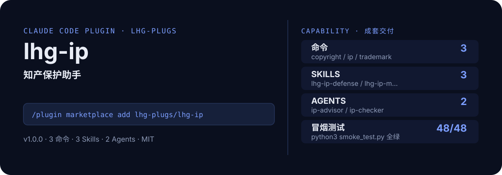

<!-- About 简介（推送后填写到仓库 About 栏）：
知产保护助手：商标/著作权/专利/商业秘密四象限判断→检索与申请流程→维权清单；非律师意见、仅供参考，流程信息以官方最新公告为准。 ｜ 一键安装：/plugin marketplace add lhg-plugs/lhg-ip
-->
<!-- topics（推送后打）：claude-code, claude-plugin, agent-skills, ip, intellectual-property, trademark, copyright, patent -->

<p align="center">
  
</p>

> **一句话介绍**：知产保护助手：商标/著作权/专利/商业秘密四象限判断→检索与申请流程→维权清单；非律师意见、仅供参考，流程信息以官方最新公告为准。

**一键安装**：在 Claude Code 里运行

```bash
/plugin marketplace add lhg-plugs/lhg-ip
/plugin install lhg-ip@lhg-plugs
```

## 它能帮你做出什么

- **冒烟全绿**：`python3 smoke_test.py` 48 项全部通过（JSON 合法、frontmatter 完整、命令/skill/agent 齐全）。

## 它是什么

`lhg-ip` 是一个 Claude Code 插件（plugin 为主、skill 为辅）：

- **3 个命令**（小白入口）：`copyright` 著作权专项、`ip` 知产保护一条龙、`trademark` 商标专项
- **3 个平台中立 skill**（方法论，可移植到豆包/Workbuddy 等 agent 平台）：lhg-ip-defense, lhg-ip-map, lhg-ip-tm
- **2 个专家 agent**：ip-advisor, ip-checker
- **1 个 hooks**（`hooks/`：pre_ip_gate.py），关键操作前自动把关

## 为什么是它

不是一个 prompt，而是一套互相兜底的机制：

1. **硬门，不是提醒**：hooks 在关键操作前自动拦截或警告（见 `hooks/`），而不是只在文档里写一句"请注意"。
2. **方法论沉淀在 skill 里**：流程、检查清单、口径都写在 `skills/` 的方法论里，命令只是入口；换个 agent 平台也能复用同一套做法。
3. **可验，不是可信**：`fixtures/` 备有坏/好对照用例，`smoke_test.py` 一键验证，规则有没有生效、自己跑一遍就知道。

## 快速上手

```bash
# 1. 安装（Claude Code 里运行）
/plugin marketplace add lhg-plugs/lhg-ip
/plugin install lhg-ip@lhg-plugs

# 2. 知产保护一条龙：输入产品名 → 商标/著作权/专利/商业秘密四象限判断 → 检索
/lhg-ip:ip "我的咖啡品牌'山野'"
```

| 命令 | 作用 | 示例 |
|---|---|---|
| `/lhg-ip:copyright` | 著作权专项：登记流程与材料清单 → 证据留存方法（时间戳/存证/公证思路）→ 侵权应对清单（附非律师意见声明）。 | `/lhg-ip:copyright "一套 UI 设计稿"` |
| `/lhg-ip:ip` | 知产保护一条龙：输入产品名 → 商标/著作权/专利/商业秘密四象限判断 → 检索指引 → 申请流程 → 维权清单（附非律… | `/lhg-ip:ip "我的咖啡品牌'山野'"` |
| `/lhg-ip:trademark` | 商标专项：尼斯分类选择思路（核心类+防御类+关联类）→ 申请流程与材料清单 → 常见驳回原因 → 驳回复审指引（附非律师… | `/lhg-ip:trademark "'山野' 咖啡"` |

## 什么时候用 / 什么时候不用（FAQ）

**什么时候用：**

- 你需要著作权专项时 → 用 `/lhg-ip:copyright`
- 你需要知产保护一条龙时 → 用 `/lhg-ip:ip`
- 你需要商标专项时 → 用 `/lhg-ip:trademark`

**什么时候不用：**

- 你只需要其中一个零散能力时 → 本插件是成套流程，单点需求用更轻量的 skill 更合适
- 你希望 AI 完全自由发挥、不接受任何自查与硬门时 → 它的规则审计与 hooks 会介入（可关，但那就别装它）
- 你的场景不在上面命令表覆盖范围内时 → 先看命令表，没有对应命令就别硬套

## 目录结构

```
lhg-ip/
├── smoke_test.py          # 一键冒烟测试
├── ATTRIBUTION.md         # 灵感来源与许可声明
├── LICENSE                # MIT
├── README.md              # 本文件
├── .claude-plugin/
├── agents/
├── commands/
├── fixtures/
├── hooks/
├── scripts/
├── skills/
```

## 自检与反馈

本插件自带质检：每次使用后可跑 `python3 smoke_test.py` 一键验证（本次实测 48 项全部通过）。

发现 bug 或有改进建议，以 `[QC] <一句话问题>` 为标题提交到 https://github.com/lhg-plugs/lhg-ip/issues，正文写清"复现步骤 → 实际表现 → 期望表现"。

同门插件见 [lhg-plugs](https://github.com/lhg-plugs)，86 个插件的完整矩阵在 [marketplace](https://github.com/lhg-plugs/marketplace) 维护。

## 出品：刘洪光

本插件由真人出镜 IP「刘洪光」（安徽合肥）出品，归属 [lhg-skills](https://github.com/lhg-skills)。

- GitHub 主页：https://github.com/lhg-skills —— 全部 skill 开源在此，欢迎 star
- 抖音：搜「刘老师讲AI实战」
- 微信：lhgsmsw
